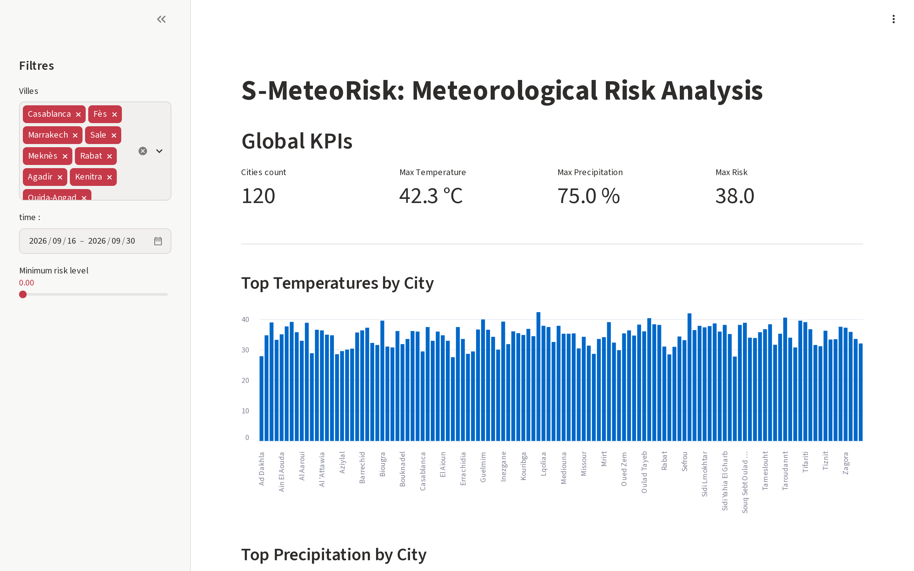
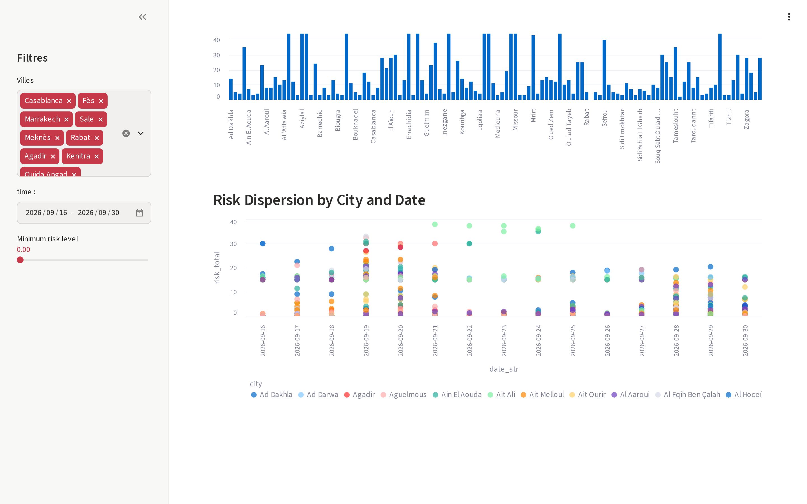
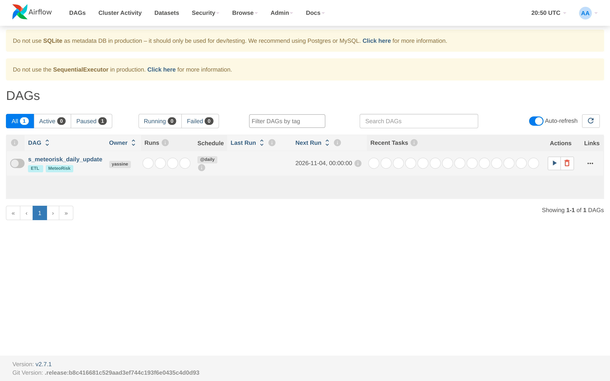
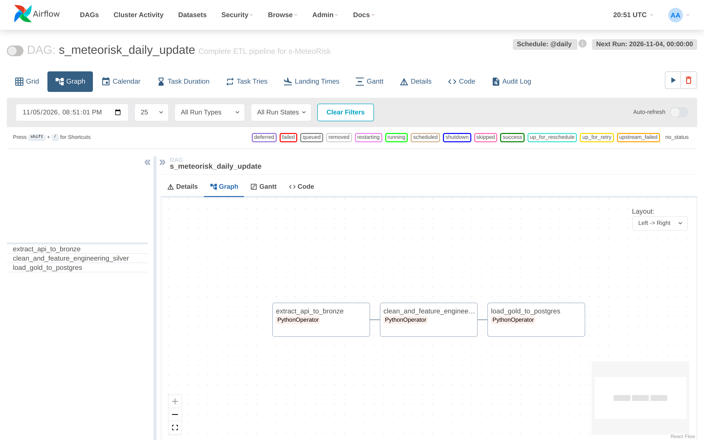
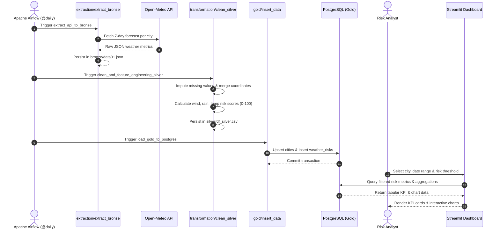
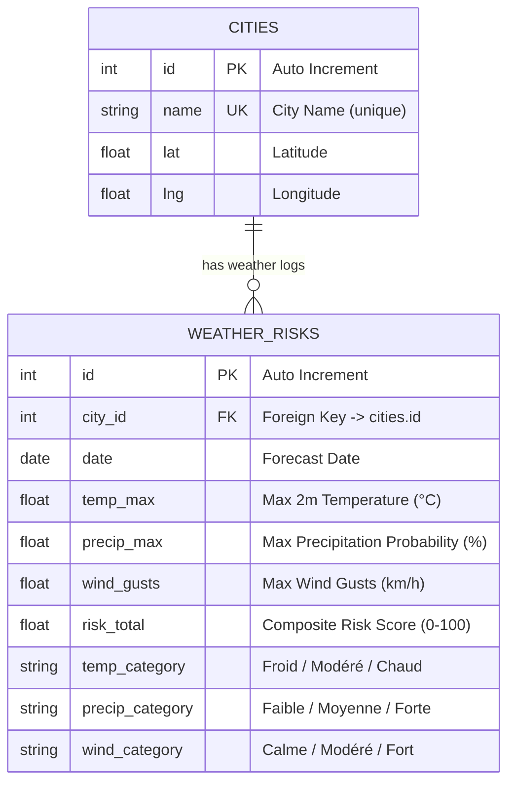

# s-MeteoRisk: Automated Meteorological Risk Intelligence Platform

[](https://www.python.org/)
[](https://airflow.apache.org/)
[](https://www.postgresql.org/)
[](https://streamlit.io/)
[](https://www.docker.com/)
[](https://opensource.org/licenses/MIT)

> An end-to-end data engineering pipeline and analytical dashboard implementing a Medallion Architecture to extract, clean, score, and visualize meteorological risks across 120 Moroccan municipalities.

---

## Demo & Visual Evidence

### 1. Interactive Analytics Dashboard
Real-time filtering of Moroccan cities, dynamic date ranges, risk sliders, and temperature/precipitation distribution.



### 2. Risk Dispersion & Trend Analysis
Multi-city risk tracking showing composite risk indices across time, high-precipitation clusters, and thermal anomalies.



### 3. Workflow Orchestration with Apache Airflow
Automated daily ETL DAG execution (`s_meteorisk_daily_update`) managing extraction, transformation, and load stages.



### 4. DAG Pipeline Dependency Graph
Task dependencies verifying sequential execution: Bronze extraction &rarr; Silver feature engineering &rarr; Gold database upsert.



---

## Key Features

- **Medallion Data Architecture**: Strict separation of concerns across **Bronze** (raw API responses), **Silver** (cleaned, validated, and enriched tables), and **Gold** (analytical star schema in PostgreSQL).
- **Automated Ingestion**: Ingests 7-day meteorological forecasts from the Open-Meteo REST API for 120 Moroccan municipalities with automatic rate-limit throttling.
- **Engineered Composite Risk Index**: Calculates a normalized 0–100 meteorological risk score combining:
  - **Wind Risk**: Categorized thresholds for gusts $>40$ km/h, $>60$ km/h, and extreme storm gusts $>85$ km/h.
  - **Rain Risk**: Weighted precipitation probability index ($30\%$ max factor).
  - **Thermal Risk**: Heat wave ($>40^\circ\text{C}$) and frost ($<2^\circ\text{C}$) thresholds.
- **Relational Storage & Modeling**: SQLAlchemy ORM models with foreign key constraints, categorizing daily risk severity (`Froid`/`Modéré`/`Chaud`, `Faible`/`Moyenne`/`Forte`, `Calme`/`Modéré`/`Fort`).
- **Orchestration**: Fully scheduled Apache Airflow pipeline running on a `@daily` cron interval with automated retries and failure handling.
- **Containerized Ecosystem**: Multi-service Docker Compose environment with isolated networking between Streamlit, Airflow, and PostgreSQL.

---

## Tech Stack

| Layer | Technology | Purpose |
|---|---|---|
| **Data Ingestion** | Open-Meteo REST API, Requests | External weather forecast data extraction |
| **Data Processing** | Python 3.11, Pandas, NumPy | Schema flattening, missing-value imputation, feature engineering |
| **Orchestration** | Apache Airflow 2.7.1 | Scheduled daily ETL DAG execution and monitoring |
| **Relational Database** | PostgreSQL 16, SQLAlchemy, pg8000 | Structured storage, ORM entity modeling, indexing |
| **Dashboard & UI** | Streamlit | Interactive web UI with KPI cards, bar charts, and scatter plots |
| **Containerization** | Docker, Docker Compose | Reproducible multi-container deployment |
| **Testing & Automation** | Playwright (Node.js) | Automated end-to-end UI verification and screenshot generation |

---

## Architecture & Diagrams

### System Architecture (Medallion Pipeline)

```mermaid
flowchart TD
    subgraph Ingestion["1. Bronze Layer (Raw Ingestion)"]
        A["Open-Meteo Forecast API"] -->|Daily Forecasts JSON| B["extraction/extract_bronze.py"]
        C[("bronze/ma.csv<br/>120 Moroccan Cities")] --> B
        B -->|Raw API Payloads| D[("bronze/data01.json")]
    end

    subgraph Transformation["2. Silver Layer (Cleaning & Risk Scoring)"]
        D --> E["transformation/json_to_df.py"]
        E -->|Flattened Tabular Data| F["transformation/clean_silver.py"]
        C -->|Geo Coordinates (lat, lng)| F
        F -->|Composite Risk Scoring (0-100)| G[("silver/df_silver.csv")]
    end

    subgraph Storage["3. Gold Layer (PostgreSQL Storage)"]
        G --> H["gold/insert_data.py"]
        H -->|Categorization & Bulk Upsert| I[("PostgreSQL 16 Database<br/>cities & weather_risks")]
        J["gold/create_db.py"] -->|SQLAlchemy DDL| I
    end

    subgraph Serving["4. Serving & Analytics"]
        I --> K["dashboard/app.py<br/>Streamlit UI (:8502)"]
        I --> L["gold/analysis.sql<br/>Analytical SQL Queries"]
    end

    subgraph Orchestration["5. Pipeline Orchestration"]
        M["Apache Airflow DAG<br/>s_meteorisk_daily_update (@daily)"] -.->|Task 1| B
        M -.->|Task 2| F
        M -.->|Task 3| H
    end
```

### Data Pipeline Execution Flow



### Database Entity-Relationship (ER) Diagram



---

## Getting Started

### Prerequisites
- [Docker](https://docs.docker.com/get-docker/) (v24+) & [Docker Compose](https://docs.docker.com/compose/) (v2+)
- *(Optional for running outside Docker)*: Python 3.11+, PostgreSQL 16+

### 1. Clone the Repository
```bash
git clone https://github.com/yassinmaftah/s-MeteoRisk.git
cd s-MeteoRisk
```

### 2. Environment Configuration
Copy the template `.env.example` to create `.env`:
```bash
cp .env.example .env
```

Default configuration in `.env`:
```env
DB_USER=postgres
DB_PASSWORD=postgres
DB_HOST=db
DB_PORT=5432
DB_NAME=s_meteorisk_db
AIRFLOW_WWW_USER_USERNAME=airflow
AIRFLOW_WWW_USER_PASSWORD=airflow
STREAMLIT_PORT=8502
```

### 3. Run with Docker (Recommended)
Launch the complete stack (PostgreSQL, Airflow Webserver, Airflow Scheduler, and Streamlit Dashboard):

```bash
# 1. Initialize Airflow metadata and create admin user
docker compose up airflow-init

# 2. Start all services in background
docker compose up -d

# 3. Initialize PostgreSQL tables and seed data
docker compose run --rm -e PYTHONPATH=/app pipeline python gold/create_db.py
docker compose run --rm -e PYTHONPATH=/app pipeline python -c "from gold.insert_data import insert_silver_data; insert_silver_data()"
```

### Default Service URLs & Ports

| Service | Host URL | Default Credentials | Description |
|---|---|---|---|
| **Streamlit Dashboard** | [http://localhost:8502](http://localhost:8502) | *None* | Interactive analytical web UI |
| **Airflow Webserver** | [http://localhost:8080](http://localhost:8080) | `airflow` / `airflow` | DAG orchestration UI |
| **PostgreSQL Database** | `localhost:5432` | `postgres` / `postgres` | Relational Gold storage |

### 4. Run Without Docker (Local Development)
```bash
# Create and activate virtual environment
python -m venv venv
source venv/bin/activate  # On Windows: .\venv\Scripts\activate

# Install dependencies
pip install -r requirements.txt

# Run pipeline stages manually
python extraction/extract_bronze.py
python -m transformation.clean_silver
python gold/create_db.py
python -c "from gold.insert_data import insert_silver_data; insert_silver_data()"

# Start Streamlit dashboard
streamlit run dashboard/app.py
```

---

## Project Structure

```plaintext
s-MeteoRisk/
├── .dockerignore                 # Excludes caches, venvs, and logs from Docker builds
├── .env.example                  # Environment configuration template
├── .gitignore                    # Git ignore file for secrets, logs, and artifacts
├── Dockerfile                    # Container image definition for pipeline & dashboard
├── docker-compose.yml            # Multi-service specification (db, airflow, dashboard)
├── requirements.txt              # Production Python dependencies
├── bronze/                       # Bronze Layer: Ingestion artifacts
│   ├── ma.csv                    # Reference directory of 120 Moroccan municipalities
│   ├── data01.json               # Extracted raw API forecasts
│   └── raw_data.json             # Supplementary raw payload archive
├── dags/                         # Apache Airflow workflow definitions
│   └── meteorisk_pipeline.py     # Directed Acyclic Graph (DAG) for daily ETL
├── dashboard/                    # Streamlit analytical user interface
│   └── app.py                    # Multi-filter interactive dashboard application
├── digrams/                      # Architecture and database schema references
│   └── image.png                 # Source ER diagram reference
├── docs/                         # Documentation, evidence, and analytical reports
│   ├── api-examples.md           # API request/response specifications and SQL queries
│   ├── results/
│   │   └── pipeline-metrics.md   # Statistical metrics, risk scores, and ranked outputs
│   └── screenshots/              # High-resolution screenshots of UI & orchestration
│       ├── 01-dashboard-overview.png
│       ├── 02-dashboard-risk-analysis.png
│       ├── 03-airflow-dags.png
│       └── 04-airflow-dag-graph.png
├── extraction/                   # Bronze Layer processing modules
│   └── extract_bronze.py         # Open-Meteo API ingestion engine
├── gold/                         # Gold Layer: Relational models and loads
│   ├── analysis.sql              # Predefined analytical SQL queries
│   ├── create_db.py              # SQLAlchemy ORM schema and table initializers
│   └── insert_data.py            # Categorization logic and database bulk upsert
├── scripts/                      # Automation & testing utilities
│   └── screenshots.js            # Reusable Playwright script for UI capture
├── silver/                       # Silver Layer: Cleaned and structured datasets
│   └── df_silver.csv             # Feature-engineered tabular dataset
└── transformation/               # Silver Layer transformation modules
    ├── clean_silver.py           # Imputation, coordinate joins, and risk calculation
    └── json_to_df.py             # JSON flattener converting payloads to DataFrames
```

---

## API Reference & Usage Examples

### Fetch Open-Meteo Forecast
```bash
curl -X GET "https://api.open-meteo.com/v1/forecast?latitude=33.5992&longitude=-7.6200&daily=temperature_2m_max,precipitation_probability_max,wind_gusts_10m_max&timezone=auto"
```

### Execute Gold Analytical Queries
Run analytical queries directly inside the PostgreSQL container:

```bash
docker compose exec -u postgres db psql -d s_meteorisk_db -c "
SELECT c.name, MAX(w.temp_max) AS top_temp, AVG(w.risk_total) AS avg_risk
FROM cities c
JOIN weather_risks w ON w.city_id = c.id
GROUP BY c.name
ORDER BY top_temp DESC
LIMIT 5;
"
```

**Real Output:**
```plaintext
    name     | top_temp |      avg_risk      
-------------+----------+--------------------
 Laâyoune    |     42.3 | 15.086666666666666
 Semara      |     41.9 |  17.76666666666667
 Taroudannt  |     40.5 | 15.733333333333333
 Oulad Teïma |     40.3 | 14.473333333333333
 Guelmim     |     39.9 | 14.453333333333332
```

---

## Results & Quantitative Metrics

Summary statistics verified across the dataset:
- **Total Municipalities Monitored**: 120 cities across Morocco.
- **Dataset Size**: 840 forecast records per rolling weekly cycle; 1,800 records tracked in Gold storage.
- **Extreme Temperature Recorded**: **$42.3^\circ\text{C}$** in *Laâyoune*.
- **Peak Precipitation Probability**: **$75.0\%$** in *Bou Arfa*.
- **Highest Average Risk Municipalities**:
  1. *Semara*: 17.77 composite risk index
  2. *Taroudannt*: 15.73 composite risk index
  3. *Laâyoune*: 15.09 composite risk index

For full statistical tables and distributions, see [`docs/results/pipeline-metrics.md`](docs/results/pipeline-metrics.md).

---

## What I Learned & Engineering Challenges

1. **Robust Medallion Architecture**: Maintaining idempotent transitions between the Bronze JSON archive and Silver CSV tables prevented schema drift and allowed seamless backfilling without re-querying external APIs.
2. **Container Networking & DNS**: Orchestrating Airflow, PostgreSQL, and Streamlit required configuring internal Docker DNS (`DB_HOST=db`) while keeping ports mapped for host access (`localhost:8502`).
3. **Handling High-Cardinality Geo-Data**: Enforcing relational integrity via foreign key relationships in SQLAlchemy ensured that city metadata remained consistent across daily forecast updates.

---

## Future Improvements

- [ ] **Predictive Machine Learning**: Train an anomaly detection model (e.g., Isolation Forest or XGBoost) to predict weather-related emergency alerts rather than relying strictly on heuristic thresholds.
- [ ] **Geospatial Choropleth Maps**: Enhance the Streamlit dashboard with PyDeck / Folium maps displaying real-time colored polygon boundaries for Moroccan provinces.
- [ ] **Automated Alerting**: Integrate Slack or Telegram webhooks into the Airflow DAG to broadcast notifications when municipality risk exceeds 50.

---

## Author

- **Author**: [Yassine Maftah](https://github.com/yassinmaftah)
- **GitHub**: [@yassinmaftah](https://github.com/yassinmaftah)
- **LinkedIn**: [Yassine Maftah](https://www.linkedin.com/in/yassine-maftah/)
- **Portfolio / Project Link**: [s-MeteoRisk](https://github.com/yassinmaftah/s-MeteoRisk)
